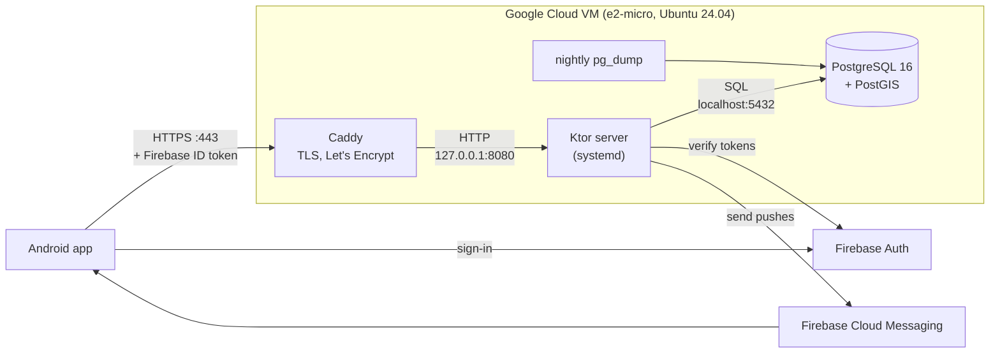

# Handover: hosting the BloodDonor server

This guide is for hosting the BloodDonor backend on **your own Google Cloud project**. It assumes you
know Google Cloud well but have never seen this codebase. The step-by-step commands are in
[`deploy/README.md`](deploy/README.md); this page explains what you are deploying, every setting,
how to check it once it's live, and what to send back.

## What the system is

BloodDonor matches urgent blood requests in Lebanon with compatible, eligible donors near the
hospital and notifies them in widening waves.

- **Android app** (Kotlin, Jetpack Compose): signs users in with Firebase and calls the API over HTTPS.
- **Ktor server** (Kotlin, Java 21): the JSON API in `server/`, plus background jobs that send the
  next notification wave every couple of minutes.
- **PostgreSQL 16 + PostGIS**: all data; PostGIS finds donors by distance from the hospital.
  The schema, areas and hospitals are created by Flyway migrations on the server's first start.
- **Firebase Authentication**: sign-in. The app sends a Firebase ID token with every call; the server
  verifies it with the Firebase Admin SDK (a service account key).
- **Firebase Cloud Messaging (FCM)**: push notifications, sent by the server with the same key.

The Firebase project (`blooddonor-df959`) stays in my account; you only need its service account key.



Only Caddy is reachable from the internet (ports 80 and 443). The server listens on `127.0.0.1`
and PostgreSQL on `localhost`.

## Requirements

- **Java 21** (the VM only needs `openjdk-21-jre-headless`; building needs a JDK 21 on your machine).
- **PostgreSQL 16 with PostGIS 3** (`postgresql-16`, `postgresql-16-postgis-3` on Ubuntu 24.04).
  The `postgis` extension must be created by a superuser; `deploy/db-setup.sql` does that.
- **The Firebase service account JSON**: I'll send it to you privately. Keep it out of any repository,
  chat history or bucket; on the VM it lives at `/etc/blooddonor/firebase-service-account.json`
  (owner `blooddonor`, mode 600).
- **`FIREBASE_PROJECT_ID=blooddonor-df959`**.
- **A domain name** for HTTPS. The kit assumes a free DuckDNS subdomain pointed at a static IP.

No tables need to be created by hand: **Flyway creates all of them on first start**, and runs any
new migrations on every later start.

## Server environment variables

The server reads only environment variables. In production they live in
`/etc/blooddonor/server.env` (template: [`deploy/server.env.example`](deploy/server.env.example));
for local development, in `server/.env` (template: [`server/.env.example`](server/.env.example)).
The examples below are not real secrets.

### Required

| Variable | What it does | Example |
|---|---|---|
| `DB_URL` | JDBC URL of the database | `jdbc:postgresql://127.0.0.1:5432/blooddonor` |
| `DB_USER` | Role the server runs as: may only read and write rows | `blooddonor_runtime` |
| `DB_PASSWORD` | Its password | `<runtime-password>` (generated in setup) |
| `FIREBASE_PROJECT_ID` | Firebase project whose ID tokens are accepted | `blooddonor-df959` |
| `FIREBASE_CREDENTIALS_PATH` | Path to the service account JSON (token checks, account deletion, FCM) | `/etc/blooddonor/firebase-service-account.json` |

### Network and database roles (optional, set in production)

| Variable | What it does | Default | Production |
|---|---|---|---|
| `HOST` | Address to listen on | `127.0.0.1` | `127.0.0.1` |
| `PORT` | Port to listen on | `8080` | `8080` |
| `TRUSTED_PROXY_IPS` | Comma-separated reverse-proxy IPs whose `X-Forwarded-For` is believed (per-IP rate limits) | none | `127.0.0.1` |
| `MAX_CONNECTIONS` | Open connections at most; more are closed at once | `500` | `500` |
| `DB_MIGRATION_USER` | Schema owner that runs the Flyway migrations; unset = migrate as `DB_USER` | none | `blooddonor_migrator` |
| `DB_MIGRATION_PASSWORD` | Its password | none | `<migrator-password>` |

### Donor matching (optional, defaults are the intended values)

| Variable | What it does | Default |
|---|---|---|
| `DONATION_GAP_DAYS_MALE` | Days after a donation before a male donor is alerted again | `90` |
| `DONATION_GAP_DAYS_FEMALE` | Same for female donors | `120` |
| `DONATION_GAP_DAYS_UNKNOWN_SEX` | Same when sex isn't given | `120` |
| `WAVE_1_RADIUS_KM` | Search radius of the first wave, sent at once | `15` |
| `WAVE_2_AFTER_MINUTES` / `WAVE_2_RADIUS_KM` | Second wave: when, and how far | `30` / `30` |
| `WAVE_3_AFTER_MINUTES` / `WAVE_3_RADIUS_KM` | Third wave | `60` / `60` |
| `WAVE_4_AFTER_MINUTES` | Fourth wave, all of Lebanon | `120` |
| `MAX_DONORS_PER_WAVE` | Closest donors alerted per wave | `50` |
| `MAX_NOTIFICATIONS_PER_24H` | Alerts per donor per 24 hours | `3` |
| `JOB_INTERVAL_MINUTES` | How often the background job sends due waves | `2` |
| `ARRIVAL_WINDOW_MINUTES` | A donor who said "I can help" stops counting after this (or at the deadline) | `180` |
| `HELPER_BUFFER` | Waves stop at units needed plus this many helpers | `1` |

### Anti-spam and safety (optional, defaults are the intended values)

| Variable | What it does | Default |
|---|---|---|
| `MAX_OPEN_REQUESTS` | Open requests per user | `2` |
| `MAX_OPEN_REQUESTS_NEW_ACCOUNT` | Same for accounts younger than `NEW_ACCOUNT_DAYS` | `1` |
| `NEW_ACCOUNT_DAYS` | Age below which an account counts as new | `7` |
| `MAX_REQUESTS_PER_24H` | Requests a user may post per 24 hours | `3` |
| `REPORTS_TO_HIDE` | Reports from different users that hide a request and give its author a strike | `3` |
| `FIRST_STRIKE_SUSPENSION_DAYS` | Posting suspension after a first strike | `7` |
| `SECOND_STRIKE_SUSPENSION_DAYS` | After a second strike within `SECOND_STRIKE_WINDOW_DAYS` | `30` |
| `SECOND_STRIKE_WINDOW_DAYS` | Window for the second strike | `90` |
| `STRIKES_FOR_PERMANENT_SUSPENSION` | Strikes that suspend posting for good | `3` |
| `NO_SHOW_REQUESTERS_TO_PAUSE` | No-shows from this many different requesters... | `3` |
| `NO_SHOW_WINDOW_DAYS` | ...within this many days... | `90` |
| `NO_SHOW_PAUSE_DAYS` | ...pause that donor's alerts this long | `30` |
| `RATE_LIMIT_GENERAL_PER_MINUTE` | Calls per user (or per IP for public routes) per minute | `120` |
| `RATE_LIMIT_POST_REQUEST_PER_MINUTE` | Posting a request | `5` |
| `RATE_LIMIT_HELP_PER_MINUTE` | "I can help" and withdrawing | `10` |
| `RATE_LIMIT_REPORT_PER_MINUTE` | Reporting a request | `5` |
| `RATE_LIMIT_BLOCKS_PER_MINUTE` | Blocking and unblocking | `20` |
| `RATE_LIMIT_PROFILE_PER_MINUTE` | `PUT` and `DELETE /api/v1/me` | `10` |
| `RATE_LIMIT_DEVICE_TOKEN_PER_MINUTE` | Registering and removing push tokens | `10` |
| `RATE_LIMIT_WRITE_PER_MINUTE` | Fulfil, cancel, confirm a helper, "Did you donate?" | `30` |

An invalid value (not a positive whole number) stops the server at start-up with a clear message
in `journalctl -u blooddonor`.

## Building and running

The server is a plain Gradle `application`. From the repository root, with a JDK 21:

```bash
./gradlew :server:test           # 190 tests, no database or Firebase needed
./gradlew :server:distTar        # → server/build/distributions/server.tar
```

No Android SDK or `google-services.json` is needed for these tasks. `server.tar` unpacks to
`server/bin/server` (start script) and `server/lib/` (jars). Running it locally needs the
variables above set; `./gradlew :server:run` loads them from `server/.env`.

## Deploying with the kit

[`deploy/`](deploy/) holds everything for one e2-micro VM; [`deploy/README.md`](deploy/README.md)
has the exact commands. In short:

1. **Google Cloud**: e2-micro with Ubuntu 24.04, static external IP, VPC firewall allowing 80/443.
2. **DuckDNS**: point your subdomain at the static IP.
3. **`sudo bash deploy/setup-vm.sh`**: swap, unattended upgrades, ufw (22/80/443), fail2ban,
   Java 21, PostgreSQL 16 + PostGIS (tuned for 1 GB, localhost only), Caddy, the `blooddonor` user,
   and the systemd units.
4. **`deploy/db-setup.sql`**: the database, PostGIS, and two roles. `blooddonor_migrator` owns the
   schema and runs Flyway; `blooddonor_runtime` can only read and write rows.
5. **Secrets**: the service account JSON and `/etc/blooddonor/server.env`, both mode 600.
6. **`sudo /opt/blooddonor/bin/update.sh ~/server.tar`**: installs the build, starts the service
   (Flyway creates the tables), waits for `/health`, and rolls back if it fails.
7. **Lock Flyway's history table** for the runtime role (one `REVOKE`).
8. **Caddy**: set the domain in the `Caddyfile`, validate, reload. HTTPS is automatic.
9. **Backups**: enable the nightly timer and take one by hand.

Later updates are just a new `server.tar` and `update.sh` again (step 6).

## Testing once it's live

Replace the domain with yours:

```bash
curl https://blooddonor-example.duckdns.org/health
# OK   (503 "Unavailable" means the server is up but can't reach the database)

curl https://blooddonor-example.duckdns.org/api/v1/areas
# a JSON list of Lebanese areas: the database was migrated and seeded

curl -i https://blooddonor-example.duckdns.org/api/v1/me
# HTTP/2 401  {"error":"unauthorized",...}: authenticated routes refuse calls without a token
```

Also worth a look: `sudo ss -tlnp` shows `8080` and `5432` on `127.0.0.1` only, and
`http://` redirects to `https://`.

**Full end-to-end testing is done with the Android APK I'll send you.** Calls from the app carry a
real Firebase ID token, so sign-in, profiles, requests, matching and push notifications can only be
checked from the app. The release build has the server address compiled in, which is why I need
your HTTPS address (below) before I can build it.

## Security expectations

- **PostgreSQL on localhost only**: `listen_addresses = 'localhost'`, never opened in ufw or the VPC
  firewall. Use `gcloud compute ssh` with a tunnel if you need a remote SQL client.
- **The server bound to `127.0.0.1`** (`HOST=127.0.0.1`): the only way in is Caddy.
- **HTTPS via Caddy** with automatic Let's Encrypt certificates and renewal; plain HTTP only
  redirects. The release app refuses any non-HTTPS server.
- **Firewall**: ufw and the VPC firewall allow only 22, 80 and 443. fail2ban watches SSH; prefer SSH
  keys (the Google Cloud default) over passwords.
- **Least privilege**: the server runs as the `blooddonor` system user (no login shell) under a
  hardened systemd unit, with a database role that can't change the schema.
- **Backups**: a nightly `pg_dump` to `/var/backups/blooddonor`, kept 7 days. Those sit on the same
  disk, so also keep a disk snapshot schedule (or copy the dumps to a private bucket). The database
  holds names, phone numbers and emails: treat backups as personal data.
- **Never commit secrets**: not the service account JSON, not `server.env`, not database passwords.
  The repository is public. Logs avoid personal data by design; keep it that way when debugging.
- **Updates**: unattended-upgrades installs security updates automatically. Reboot now and then when
  `/var/run/reboot-required` exists.
- Security issues in the code itself: see [`SECURITY.md`](SECURITY.md).

## What to send back to me

1. **The HTTPS address** of the server, e.g. `https://blooddonor-example.duckdns.org/`. I'll build
   the release APK against it and send it to you.
2. **Confirmation that `/health` answers `OK`** over HTTPS (and, ideally, that `/api/v1/areas`
   returns the list and `/api/v1/me` returns 401).

Please don't send passwords, `server.env` or the service account key back; nothing on my side needs
them.
