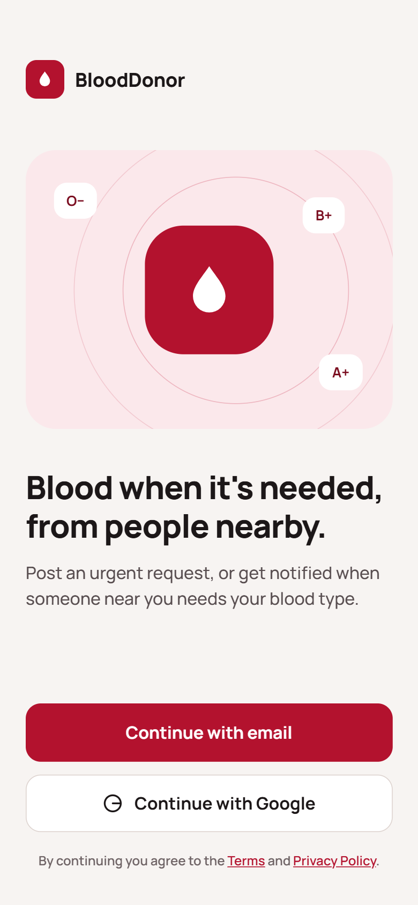
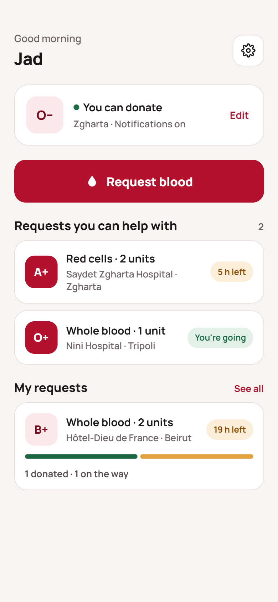
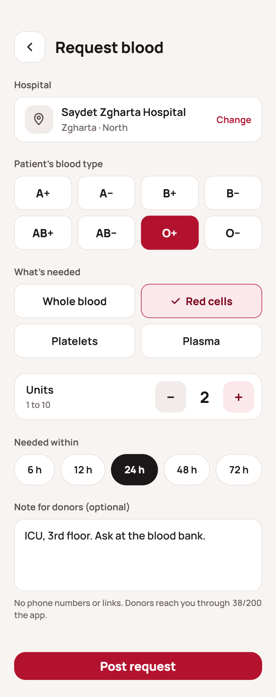
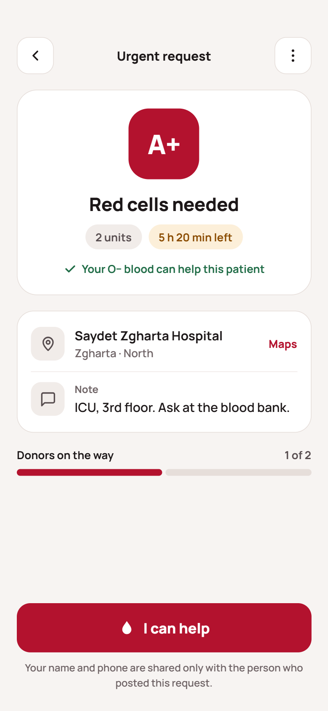
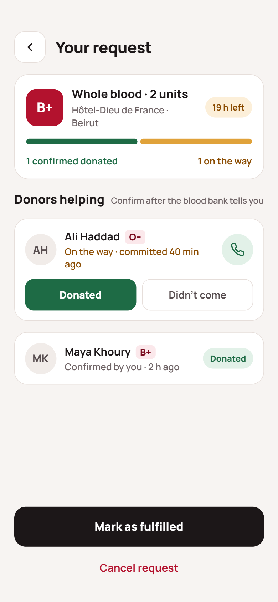
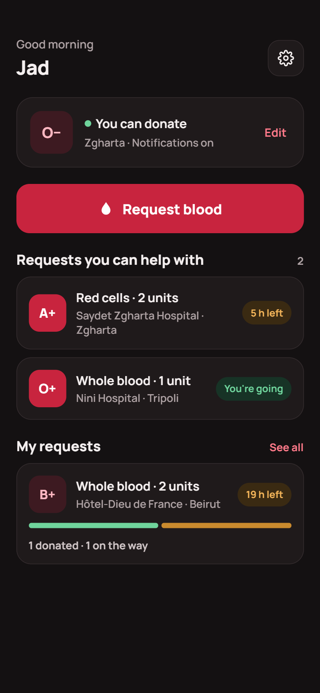
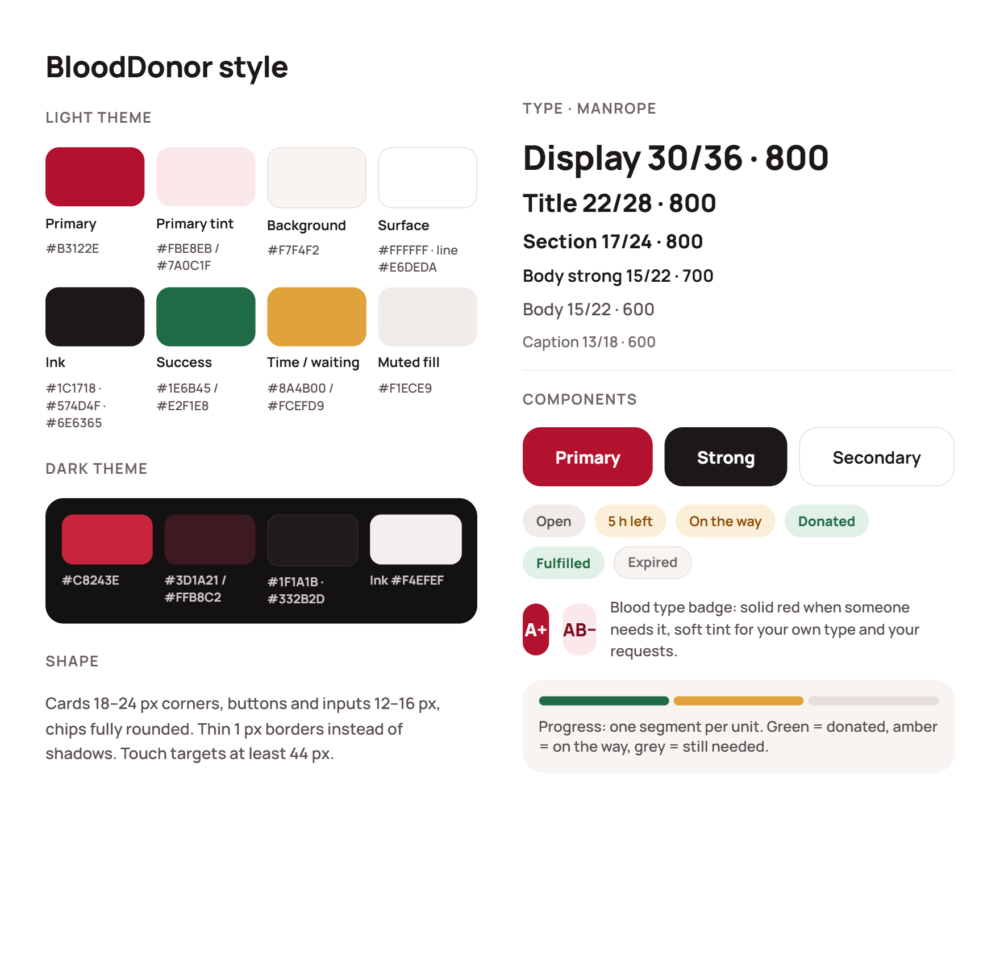
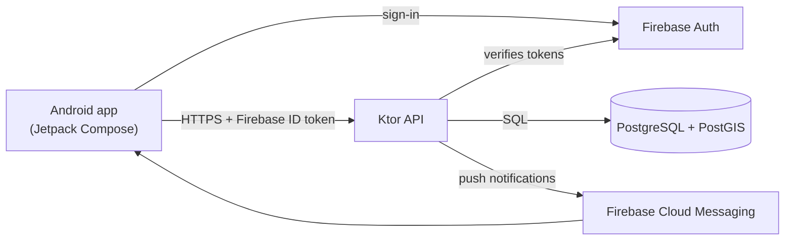

# 🩸 BloodDonor

**A blood donor matching app for Lebanon that notifies compatible, eligible donors near the hospital.**

[](https://github.com/Jadd017/blood-donor-app/actions/workflows/ci.yml)
[](https://github.com/Jadd017/blood-donor-app/actions/workflows/codeql.yml)


In Lebanon, urgent blood requests are usually shared in WhatsApp groups and on social media. They reach thousands of people who can't help (wrong blood type, too far away, or donated recently), phone numbers end up posted publicly, and old requests keep circulating long after the need is met.

BloodDonor sends each request only to the people who can actually help: donors whose blood type is compatible with the component needed, who are eligible to donate again, and who live near the hospital. If not enough of them respond, the search radius widens automatically.

---

## Design

<table>
  <tr>
    <td align="center"><br><sub><b>Welcome</b>: sign in with email or Google</sub></td>
    <td align="center"><br><sub><b>Home</b>: eligibility, requests I can help with, my requests</sub></td>
    <td align="center"><br><sub><b>Request blood</b>: hospital, blood type, component, units, deadline</sub></td>
  </tr>
  <tr>
    <td align="center"><br><sub><b>Donor view</b>: what's needed, where, and "I can help"</sub></td>
    <td align="center"><br><sub><b>Requester view</b>: progress and the donors on their way</sub></td>
    <td align="center"><br><sub><b>Dark mode</b>: home</sub></td>
  </tr>
</table>

<p align="center"></p>

<sub>These are design mockups with example data; names, hospitals and times are illustrative.</sub>

---

## Features

- **Sign-in:** email and password with required email verification and password reset, plus Google Sign-In.
- **Profile:** name, Lebanese mobile number (one account per number), blood type, area, last donation date and alert opt-in.
- **Hospitals:** Lebanese hospitals imported from OpenStreetMap, cleaned of clinics, dispensaries and duplicates.
- **Blood requests:** patient blood type, component (whole blood, red cells, platelets or plasma), units, deadline and an optional note, with compatibility rules for each component.
- **Eligibility:** donors are only alerted once enough time has passed since their last donation (configurable interval).
- **Push notifications** in waves with a widening search radius: 15 km → 30 km → 60 km → all of Lebanon, at most 50 closest donors per wave and 3 alerts per donor per day.
- **"I can help":** a donor commits to a request, and only then is their name and phone number shared with the requester.
- **Requester confirmation:** the requester confirms who donated; a donor who doesn't come stops counting, and more donors are notified.
- **No-show handling:** a donor marked as a no-show by several different requesters gets no alerts for a while.
- **Automatic anti-spam:** open-request and daily limits (stricter for new accounts), duplicate detection and per-user rate limits; reported requests are hidden and closed, strikes suspend posting, and anyone can be blocked.
- **Account deletion** in the app: open requests are cancelled, and past requests and donations are kept without the person.

## Tech stack

| Layer | Technology |
|---|---|
| Android app | Kotlin, Jetpack Compose, Material 3 |
| Backend | Ktor (Kotlin) |
| Database | PostgreSQL + PostGIS, Flyway migrations, Exposed |
| Auth and push | Firebase Authentication, Firebase Cloud Messaging |
| Hosting | Google Cloud (planned) |

## Architecture



The app signs in with Firebase and sends its ID token with every API call; the server verifies it with the Firebase Admin SDK. Matching runs in SQL: PostGIS finds compatible, eligible donors by distance from the hospital, and the server sends the alerts through FCM.

## Privacy & safety

- Phone numbers are never shown in requests; a donor's number is shared only with the requester, and only after the donor taps "I can help".
- Notes can't contain phone numbers or links, and donors never see who posted a request until they commit.
- Reports, strikes, blocking and rate limits work automatically, without an admin.
- Users can delete their account in the app; their past requests and donations stay without their name.

## Status

🚧 **In development.** The app and server run end to end locally. Next steps: deploy the server to Google Cloud and publish the app on Google Play.

---

## Running it locally

### Requirements

- Android Studio (its bundled JBR is used as the JDK)
- PostgreSQL with the PostGIS extension
- A Firebase project with Email/Password and Google sign-in enabled

### Firebase config

`app/google-services.json` and the server's service account key are **not** committed to this repository.

1. In the [Firebase console](https://console.firebase.google.com/), open **Project settings → General → Your apps** and select (or add) the Android app `com.jadbarakat.blooddonor`.
2. Download `google-services.json` and place it in `app/`.
3. Under **Project settings → Service accounts**, generate a private key and keep it **outside** the repository.

### Server

1. Create a database and enable PostGIS (as a superuser): `CREATE EXTENSION postgis;`
2. Copy `server/.env.example` to `server/.env` and fill in the database settings and the path to the service account key. `server/.env` is git-ignored. All matching and anti-spam thresholds are optional settings documented in that file.
3. Run `./gradlew :server:run`. Flyway applies the migrations on start-up, and `http://localhost:8080/health` reports the server and database status.

### App

Build and install with `./gradlew :app:installDebug`. The debug build talks to `http://localhost:8080/`, so forward the port from the phone with `adb reverse tcp:8080 tcp:8080` (or use `dev/dev-run.ps1` below).

### Developer scripts

PowerShell helpers in `dev/` for local testing only; they're never used in production.

- **`dev/reset-test-data.ps1`** clears every user's last donation date and notification pause, cancels all open requests, and deletes all request notifications, pledges, reports, strikes and blocks in the local database, so the same accounts can be matched again. It reads connection settings from `server/.env`, refuses to run unless the database host is localhost, and prints what it changed.
- **`dev/dev-run.ps1`** points `JAVA_HOME` at Android Studio's JBR, restarts adb, installs the debug app on every connected device, sets up `adb reverse tcp:8080 tcp:8080` on each one, and launches the app. It warns if the server isn't answering on `http://localhost:8080/health`.

```powershell
powershell -ExecutionPolicy Bypass -File dev\reset-test-data.ps1
powershell -ExecutionPolicy Bypass -File dev\dev-run.ps1
```
